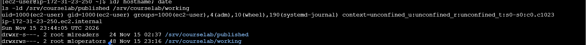
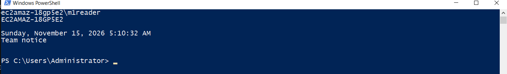
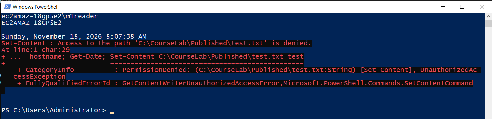

---
layout: default
title: Role-Based Access Baseline
permalink: /playbook/system-security.html
---

# Role-Based Access Baseline on Windows Server and Linux (AWS EC2)

## Overview
For this project, I configured role-based access controls on Windows Server 2022 and Amazon Linux 2023 using AWS EC2 instances. The goal was to let readers access published files, allow operators to update working files, and prevent a retired account from signing in.

**Knowledge Area:** System Security

**Concepts:** Confidentiality, Integrity, Systems Thinking, and Responsible AI.

## What I Did
I created three local test accounts on each server: m1reader, m1operator, and m1retired.

I configured the Published folder so readers and operators could read files without changing them. The Working folder allowed operators to create and modify files, while readers were denied access. I also disabled the retired account.

On Linux, I used useradd, groupadd, chmod, and chown. On Windows, I used PowerShell and icacls to create accounts, assign group membership, and configure permissions.

## Testing and Results
I completed five original access tests on each server, for ten total tests.

All ten tests matched their expected results. The reader could read Published but could not modify it or access Working. The operator successfully created a file in Working. The retired account was blocked from signing in.

Expected permission-denied errors counted as passing tests.

## Troubleshooting
After completing the original tests, I followed an instructor-provided scenario on Linux.

I removed the group write permission from the Working folder using:

`sudo chmod g-w /srv/courselab/working`

When I tested file creation as m1operator, I received Permission denied.

I investigated the group membership and folder permissions and discovered the missing group write permission. I corrected the problem using:

`sudo chmod g+w /srv/courselab/working`

I repeated the same test successfully and confirmed that the folder permissions were restored.

## Evidence

### Linux configuration

### Windows reader allowed

### Windows reader denied

## AI Use and Verification
I used ChatGPT to help interpret the Windows Published folder permissions shown by icacls.

ChatGPT explained the RX, F, OI, and CI permissions. I verified the explanation against my actual Windows permission output and reader access tests.

I did not execute any AI-generated permission changes.

## What I Learned
This project helped me understand how groups and file permissions work on Linux and Windows.

I learned that checking permissions is not enough by itself. Testing access as the actual user is necessary to confirm that the configuration works.

I also learned how to troubleshoot a permission problem by finding the cause, making a small correction, and testing again.

## Professional Connection
Role-based access control is important in real workplaces because employees should only have access to the information and resources needed for their jobs.

Using least privilege protects sensitive information and helps prevent unauthorized changes. These skills apply to system administration, cybersecurity, and cloud infrastructure management.
